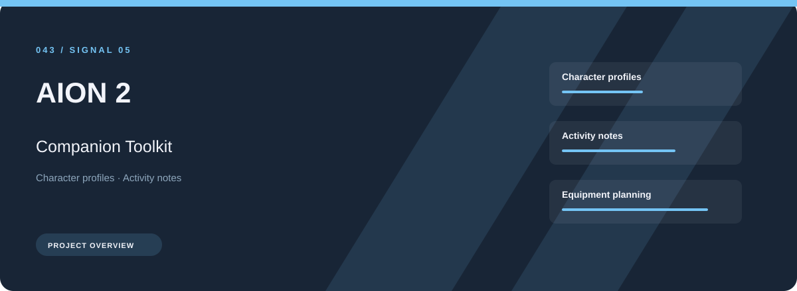
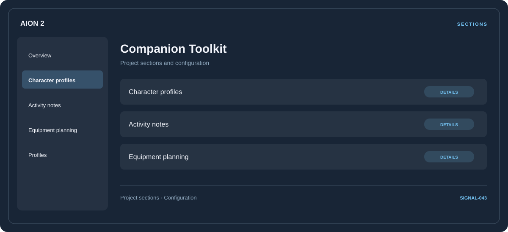

# 🧭 AION 2 Companion Toolkit

**Character profiles · Activity notes · Equipment planning**

## ⚡ Features

AION 2 Companion Toolkit focuses on three connected areas: character profiles, activity notes, equipment planning. Its organization keeps frequently used options close to the context they belong to.

### ⚙️ Character profiles

Related settings collected into named groups for a clearer configuration workflow.

### 🧩 Activity notes

Session and activity information grouped by the task or context it belongs to.

### ⌨️ Equipment planning

Equipment categories and the associated selection or configuration options.

## 🖥️ Project navigation

## 📥 Download

The button and cover open the project's download page. Use the information supplied with the downloaded package for installation and release-specific requirements.

## 📚 Project documentation

- [Feature reference](docs/FEATURES.md)
- [Download information](docs/DOWNLOAD.md)
- [Project page](index.html)

---

AION 2 Companion Toolkit · Program documentation and download information.
